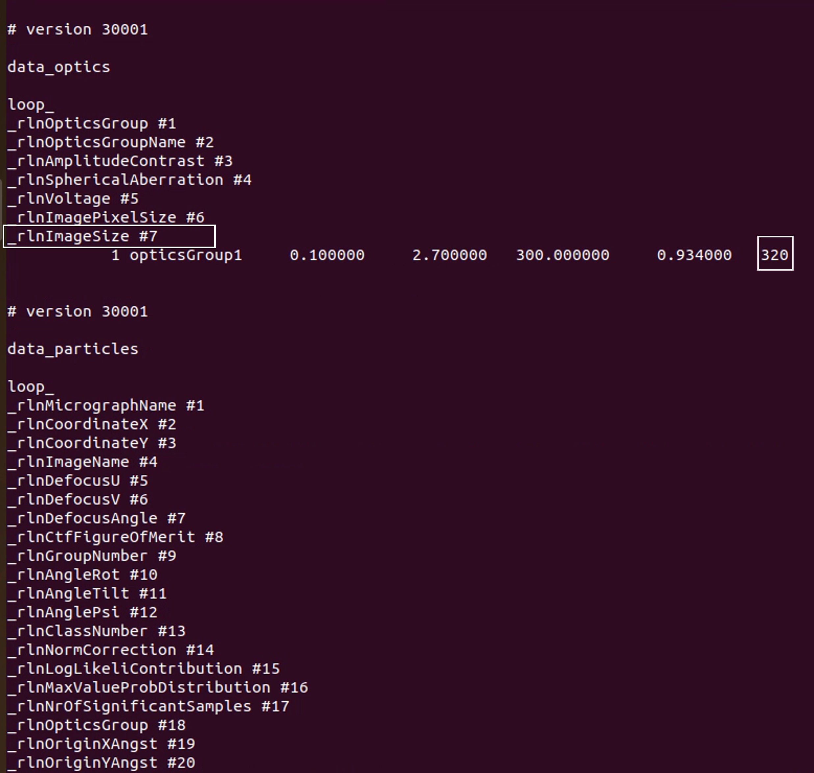

# isSPA-vesicle v0.0.1

Welcome to use isSPA-vesicle! A tool for vesicle geometry-guided post hoc filtering of particles in .star files, especially for isSPA-detected particles. In practice, I recommend using version v0.0.3. 

## 1. Function Overview

1. This tool filters protein orientations in `.star` files based on vesicle geometric information.

2. During alignment of protein coordinates to vesicle membrane coordinates, the Block-Based Reconstruction (BBR) method is adopted to shift protein coordinates.(https://github.com/homurachan/Block-based-recontruction)

## 2. **Functional Differences (vs v0.0.3)**

1. v0.0.1 calls an external BBR environment and relies on BBR to shift protein coordinates for their alignment with membrane coordinates.

2. v0.0.3 removes the external software dependency and requires no `.star` file format conversion. During coordinate alignment, protein coordinates remain unchanged; instead, the membrane radius is expanded outward to the box center of the 3D template used for particle picking. This version is recommended for easier operation.

## 3. Installation

1. For detailed installation and usage of BBR, please refer to (https://github.com/homurachan/Block-based-recontruction).

2. To prevent conflicts between this software’s environment and other environments on your machine, we recommend creating a virtual environment. See the Installation section of v0.0.3 for installation steps.

## 4. Quick Start

### 4.1 Get Vesicle information

Version v0.0.1 is identical to v0.0.3 in this section. Please refer to the README.md of v0.0.3 (Quick Start 3.1–3.6). After completing the above steps, a `vesicle_info.txt` file will be generated.

Information contained in this `vesicle_info.txt` file is shown below:

```
predict_results/FoilHole_20229147_Data_20227118_3_20260120_150849_Fractions_lp20_hp800_ms10_pad512.mrc	image_size=4096,4096	center=694.30,155.40	radius=536.10,197.70	angle=179.81	axis_ratio=2.71	type=ellipse
predict_results/FoilHole_20229147_Data_20227118_3_20260120_150849_Fractions_lp20_hp800_ms10_pad512.mrc	image_size=4096,4096	center=1722.20,623.30	radius=395.00,349.80	angle=143.46	axis_ratio=1.13	type=ellipse
predict_results/FoilHole_20229147_Data_20227118_3_20260120_150849_Fractions_lp20_hp800_ms10_pad512.mrc	image_size=4096,4096	center=747.10,1837.40	radius=584.40,572.40	angle=193.74	axis_ratio=1.02	type=ellipse
```

### 4.2 Prepare files and BBR shifts

1. First, isSPA produces a RELION 3.0-format STAR file. Convert it to RELION 3.1 format before running BBR.

```shell
source ~/relion_BBR.cshrc  If RELION with BBR functionality has been successfully installed

relion_convert_star --i isSPA_particles_rln30.star --o isSPA_particles_rln31.star
```

2. The converted STAR file in RELION 3.1 format should contain the `_rlnImageSize` tag, as shown below:



If this tag is missing, it needs to be added manually.

3. Outer_mem_position Measure

This script measures the Z‑axis coordinate of the outer membrane.

```
python isSPA_vesicle_distance_measure_tool_BBR.py \
--filename cylinder.mrc \
--shape 320 320 320 \
--voxel_size 0.934 \
--radius 30 \
--z_range 30 70
```

Tune the `--z_range` argument until the cylinder density matches the transmembrane region of the membrane protein. The script output is used directly as input for BBR, shifting the box center of the membrane protein template to the outer membrane surface.

4. BBR shifts particles coordinates

Perform BBR shift on the particle orientations in the input STAR file. The shifted results are stored under the `_rlnOriginXAngst` and `_rlnOriginYAngst` tags of the STAR file.

```
relion_star_handler --do_BBR \
--i isSPA_particles_rln31.star --o isSPA_particles_rln31_BBR.star \
--BBR_X 160 --BBR_Y 160 --BBR_Z 56 --sym C1 --micrograph_xsize 4096 --micrograph_ysize 4096 
```

The value output from the measurement script above should be provided after the `--BBR_Z` argument.

5. particles.star recenter

Coordinates following the BBR shift are added under the `CoordinatesX` and `CoordinatesY` tags.

```
python star_file_coord_and_origin_recenter_self_adaption.py \
isSPA_particles_rln31_BBR.star \
0.934 \
isSPA_particles_rln31_BBR_recenter.star \
```

### 4.3 Filtering Particles

```
python isSPA_vesicle_constrain_optimise_BBR.py 
vesicle_info.txt \
isSPA_particles_rln31_BBR_recenter.star \
isSPA_particles_rln31_BBR_recenter_normal20-90.star \
--radius_scale 1.2 \
--distance_thres 20 --angle_thresh 90 \
--euler_ori 1 --protein_ori 1 
```

Refer to v0.0.3 for the meanings of individual arguments.

### 4.4 Find Original matching line with isSPA.lst

Because BBR conversion alters particle coordinate information, correspondence needs to be established between the file after normal-vector constraint and the original isSPA particle output file. This correspondence depends on the consistency of coordinates and Euler angles across file conversion steps in the isSPA pipeline, together with the particle order in the files.

```
python normal_constrain_star_2_gis_lst_influA.py \
isSPA_particles_rln31_BBR_recenter_normal20-90.star \
isSPA_particles_rln31_BBR_recenter.star \
isSPA_particles.lst \
isSPA_particles_rln31_BBR_recenter_normal20-90.lst
```

Among the four files provided to this script, the first three are inputs; the script uses their interrelationships to produce the `.lst` file corresponding to the first file.

## 5. Citation

BBR :

Zhu, Dongjie, et al. "Pushing the resolution limit by correcting the Ewald sphere effect in single-particle Cryo-EM reconstructions." *Nature communications* 9.1 (2018): 1552.